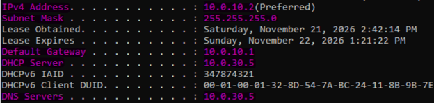
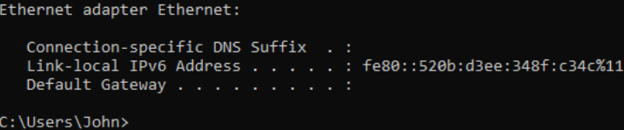
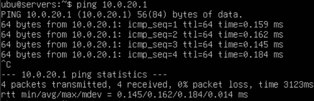
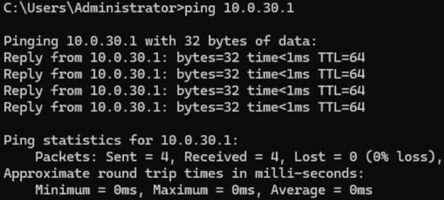

# **Connectivity Testing** 

# **Overview** 

This document outlines the connectivity tests performed on my virtual SOHO network built using Proxmox, pfSense, and Windows Server. The purpose of testing was to verify network connectivity, DHCP and DNS functionality, routing, and firewall rules. 

Testing was performed to ensure that devices could access required network services while maintaining isolation between VLANs. 

# **Testing Environment** 

|**Component**|**Description**|
|---|---|
|Hypervisor|Proxmox VE|
|Router/Firewall|pfSense|
|DHCP Server|Windows Server|
|DNS Server|Windows Server|

Network Segmentation 3 VLANs with separate subnets 

# **Test Results** 

|**Test**|**Expected Result**|**Status**|
|---|---|---|
|DHCP Address Assignment|Client receives an IP address|PASS|
|Default Gateway Connectivity|Successful ping|PASS|
|DNS Resolution|Hostname resolves to IP|PASS|
|Same-VLAN Connectivity|Devices can communicate|PASS|
|Inter-VLAN Connectivity|Traffic is blocked|PASS|
|Firewall Rule Validation|Rules enforce network isolatio|n PASS|

# **Test Procedures** 

# **1. DHCP Address Assignment** 

**Objective:** Verify that pfSense assigns IP addresses to clients on VLAN 10 (Employees). 

# **Command:** 

ipconfig /all 

ipconfig /release 

ipconfig /renew 

**Expected Result:** The client receives an IP address, subnet mask, default gateway, and DNS server from the configured DHCP settings. 

**Actual Result:** Client successfully received an IP address, subnet mask, default gateway and DNS from DHCP server. 

# **2. Default Gateway Connectivity** 

**Objective:** Verify that clients can communicate with their configured default gateway. 

# **Command:** 

Win10Client - ping 10.0.10.1 

UbuntuServer – ping 10.0.20.1 

WinServer – ping 10.0.30.1 

**Expected Result:** Successful replies from the pfSense interface assigned to the client's VLAN. 

**Actual Result:** Every client is able to successfully ping their respective VLAN interfaces. 

# **3. DNS Resolution** 

**Objective:** Verify that Windows Server provides DNS resolution to network clients. 

# **Command:** 

Win10Client - nslookup `www.facebook.com` 

<!-- Start of picture text -->
IC: \Users\John>nslookup www.facebook.com Server inKnown Non-authoritative answer: Name: star-mini.c1@r. facebook. com Addresse 2a03 : 2880: £162:81: face: b00c:0:25de Aliases: _www.facebook.com <!-- End of picture text -->

# UbuntuServer - nslookup www.facebook.com 10.0.30.5 

<!-- Start of picture text -->
ibu@servers:~$ nslookup www.facebook.com 10.0.30.5 server: Address: 10.0.36.5#53 Non-authoritative answer: www. facebook .com canonical name = star-mini Name: star-mini.c1@r.facebook.con Address: <!-- End of picture text -->

WinServer- nslookup www.facebook.com 

<!-- Start of picture text -->
C:\Users\Administrator>nsLookup www.facebook.com Server: localhost Address: Non-authoritative answer: Name : star-mini.clOr. facebook. com Addresses: 2a03:2880:f162:81:face:b00c:0:25de Aliases: www.facebook.com <!-- End of picture text -->

**Expected Result:** The DNS server returns the correct IP address of www.facebook.com **Actual Result:** DNS successfully returned correct IP address for www.facebook.com 

# **5. Firewall Rule Validation** 

**Objective:** Confirm that firewall rules enforce the intended network segmentation. 

**Procedure:** 

1. Verify that restricted traffic is blocked. 

Win10Client – ping 10.0.20.2 

<!-- Start of picture text -->
Pinging 10.0.20.2 with 32 bytes of data Request timed out. Request timed out. <!-- End of picture text -->

Ping to SERVERS subnet successfully blocked. 

ping 10.0.30.5 

<!-- Start of picture text -->
Request timed out. Request timed out Request timed out Request timed out. <!-- End of picture text -->

Ping to MANAGEMENT subnet successfully blocked. 

UbuntuServer – ping -c 4 10.0.10.2 

<!-- Start of picture text -->
buéservers:"$ ping -c 4 PING 16.0.10.2 (10.0.16.2) 56(84) byte if data 10.0.10.2 ping statistics 4 packets transmitted, @ received, » time 3058ms <!-- End of picture text -->

Ping to EMPLOYEES subnet successfully blocked. 

ping -c 4 10.0.30.5 

<!-- Start of picture text -->
10.0.30.5 ping statistics 4 packets transmitted, @ received, » time 3106ms <!-- End of picture text -->

Ping to MANAGEMENT subnet successfully blocked. 

WinServer – ping 10.0.10.2 

<!-- Start of picture text -->
C:\Users\Administrator>ping Pinging 10.0.10.2 with 32 bytes of data: Request timed out. Request timed out. Request timed out. Request timed out. Ping statistics for 10.6.10.2: Packets: Sent = 4, Received = 0, Lost = 4 ( yi <!-- End of picture text -->

Ping to EMPLOYEES subnet successfully blocked. 

ping 10.0.20.2 

<!-- Start of picture text -->
C:\Users\Administrator>ping Pinging 10.0.20.2 with 32 bytes of data: Request timed out. Request timed out. Request timed out. Request timed out. Ping statistics for 10.0.20.2: Packets: Sent = 4, Received = 0, Lost = 4 ( pie <!-- End of picture text -->

2. Review pfSense firewall rules to confirm that traffic is being denied by the configured rules. 

<!-- Start of picture text -->
Floating WAN LAN EMPLOYEES SERVERS.» MANAGEMENT Rules (Drag to Change Order) rh o States Protocol Source Port Destination Port Gateway Queue Schedule Description Actions: Y 0/43Ki8 iPr EMPLOYEES + MANAGEMENT «53. * none Allow egress ONS traffic to L709 TCP/UDP subnets subnets (0Ns) MANAGMENT subnet ax % o7eKie = IPva* EMPLOYEES * MANAGEMENT e ® none, Block egress traffic to £709 subnets subnets MANAGEMENT subnet o % o/ssoB iva EMPLOYEES * SERVERS subnets * . none Block egress traffic to SERVERS £709 subnets subnet a Y 6217.41 pvae EMPLOYEES ‘oe . " none L709 MiB subnets ax <!-- End of picture text -->

Allow DNS from MANAGEMENT subnet and blocks all other egress traffic. 

<!-- Start of picture text -->
Floating WAN LAN-—sEMPLOYEES SERVERS» MANAGEMENT Rules (Drag to Change Order) o States Protocol Source Port Destination Port Gateway Queue Schedule Description Actions VY onkiB  Pv4 SERVERS * MANAGEMENT 53 F one Allow DNS traffic from MANAGEMENT & OQ ToP/UDP subnets subnets (ONs) subnet Gx % 0/3KiB  Pvae ‘SERVERS * MANAGEMENT * * none Block egress traffic from £709 subnets subnets MANAGEMNET subnet a % 0/2KiB —IPvae SERVERS * EMPLOYEES subnets * . none Block egress traffictoemPLovesSs BAOQ subnets subnet a Y 0/208 Pv4e SERVERS * 8 . . one L709 MiB subnets Gx <!-- End of picture text -->

Allow DNS from MANAGEMENT subnet and blocks all other egress traffic. 

<!-- Start of picture text -->
Floating WAN LAN-—EMPLOYEES = SERVERS.» MANAGEMENT Rules (Drag to Change Order) is} States Protocol Source Port Destination Port Gateway Queue Schedule Description Actions: % 0/2408 IPv4* MANAGEMENT + SERVERSsubnets * * none Block egress traffic to SERVERS £7008 subnets subnet % 0/2408 IPv4* MANAGEMENT * EMPLOYEES ‘+ none Block egress tratfictoempLovees SOOT subnets subnets subnet Y 3/943 IPva* MANAGEMENT so oa none £7008 mis subnets x <!-- End of picture text -->

Block all egress traffic to other subnets. 

**Expected Result:** Restricted traffic is blocked according to the configured firewall rules. **Actual Result:** All firewall rules restrict traffic successfully. 

**Conclusion** 

All connectivity tests were completed successfully. Testing verified that clients received IP addresses through DHCP, communicated with their configured default gateways, and successfully resolved hostnames using the Windows Server DNS service. Firewall rules were also verified to ensure that unauthorized inter-VLAN traffic was blocked while allowing necessary network services. These results confirmed that routing, network segmentation, and firewall configurations were functioning as intended. 

This project provided hands-on experience with network administration, VLAN segmentation, firewall configuration, DHCP, DNS, and network troubleshooting. 

