# **Connectivity Testing** 

# **Overview** 

This document outlines the connectivity tests performed on my virtual SOHO network built using Proxmox, pfSense, and Windows Server. The purpose of testing was to verify network connectivity, DHCP and DNS functionality, routing, and firewall rules. 

Testing was performed to ensure that devices could access required network services while maintaining isolation between VLANs. 

# **Testing Environment** 

|**Component**|**Description**|
|---|---|
|Hypervisor|Proxmox VE|
|Router/Firewall|pfSense|
|DHCP Server|Windows Server|
|DNS Server|Windows Server|

Network Segmentation 3 VLANs with separate subnets 

# **Test Results** 

|**Test**|**Expected Result**|**Status**|
|---|---|---|
|DHCP Address Assignment|Client receives an IP address|PASS|
|Default Gateway Connectivity|Successful ping|PASS|
|DNS Resolution|Hostname resolves to IP|PASS|
|Same-VLAN Connectivity|Devices can communicate|PASS|
|Inter-VLAN Connectivity|Traffic is blocked|PASS|
|Firewall Rule Validation|Rules enforce network isolation| PASS|

# **Test Procedures** 

# **1. DHCP Address Assignment** 

**Objective:** Verify that pfSense assigns IP addresses to clients on VLAN 10 (Employees). 

**Command:**

ipconfig /all 

ipconfig /release 

ipconfig /renew 

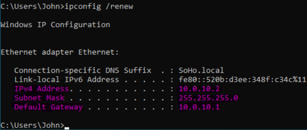

**Expected Result:** The client receives an IP address, subnet mask, default gateway, and DNS server from the configured DHCP settings. 

**Actual Result:** Client successfully received an IP address, subnet mask, default gateway and DNS from DHCP server. 

# **2. Default Gateway Connectivity** 

**Objective:** Verify that clients can communicate with their configured default gateway. 

**Command:** 

Win10Client - ping 10.0.10.1 

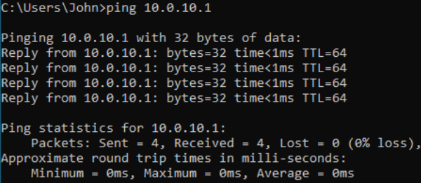

UbuntuServer – ping 10.0.20.1 

WinServer – ping 10.0.30.1 

**Expected Result:** Successful replies from the pfSense interface assigned to the client's VLAN. 

**Actual Result:** Every client can successfully ping its respective VLAN interface. 

# **3. DNS Resolution** 

**Objective:** Verify that Windows Server provides DNS resolution to network clients. 

**Command:** 

Win10Client - nslookup www.facebook.com 

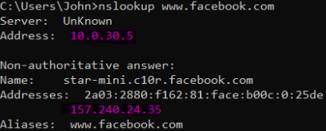

UbuntuServer - nslookup www.facebook.com 10.0.30.5 

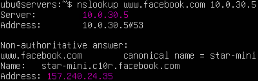

WinServer- nslookup www.facebook.com 

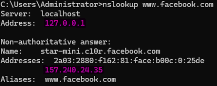

**Expected Result:** The DNS server returns the correct IP address of www.facebook.com 

**Actual Result:** DNS successfully returned correct IP address for www.facebook.com 

# **5. Firewall Rule Validation** 

**Objective:** Confirm that firewall rules enforce the intended network segmentation. 

**Procedure:** 

**1. Verify that restricted traffic between subnets is blocked.** 

Win10Client – ping 10.0.20.2 

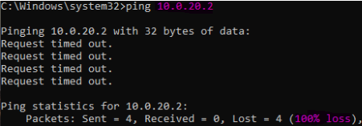

Ping to SERVERS subnet successfully blocked. 

ping 10.0.30.5 

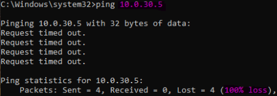

Ping to MANAGEMENT subnet successfully blocked. 

UbuntuServer – ping -c 4 10.0.10.2 

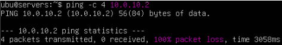

Ping to EMPLOYEES subnet successfully blocked. 

ping -c 4 10.0.30.5 

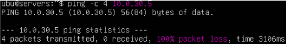

Ping to MANAGEMENT subnet successfully blocked. 

WinServer – ping 10.0.10.2 

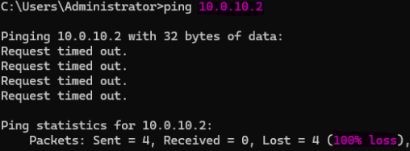

Ping to EMPLOYEES subnet successfully blocked. 

ping 10.0.20.2 

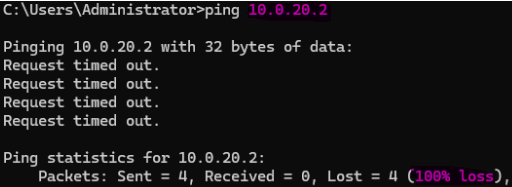

**2. Review pfSense firewall rules to confirm that traffic is being denied according to the configured rules.** 

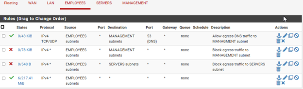

Allow DNS from MANAGEMENT subnet and blocks all other egress traffic. 

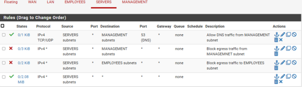

Allow DNS from MANAGEMENT subnet and blocks all other egress traffic. 

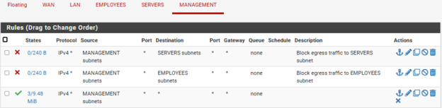

Block all egress traffic to other subnets. 

**Expected Result:** Restricted traffic is blocked according to the configured firewall rules. **Actual Result:** All firewall rules successfully restrict traffic. 

**Conclusion** 

All connectivity tests were completed successfully. Testing verified that clients received IP addresses through DHCP, communicated with their configured default gateways, and successfully resolved hostnames using the Windows Server DNS service. Firewall rules were also verified to ensure that unauthorized inter-VLAN traffic was blocked while allowing necessary network services. These results confirmed that routing, network segmentation, and firewall configurations were functioning as intended. 

This project provided hands-on experience with network administration, VLAN segmentation, firewall configuration, DHCP, DNS, and network troubleshooting. 

