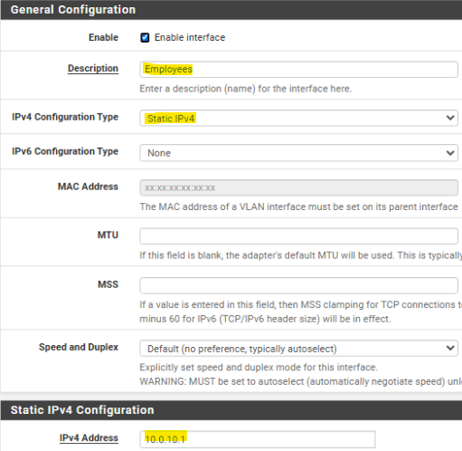
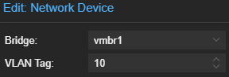
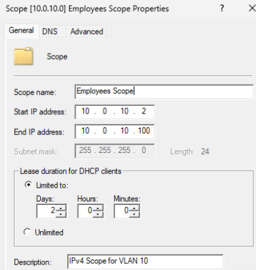
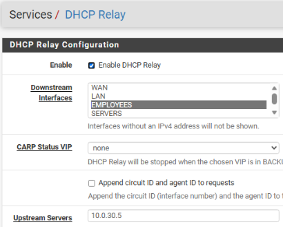
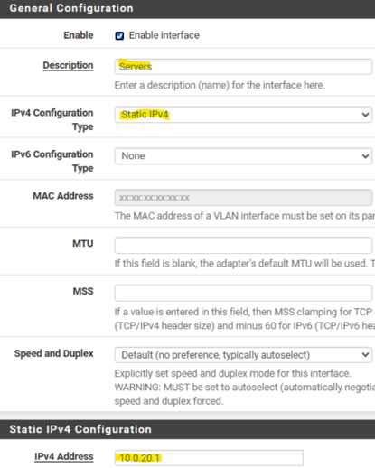
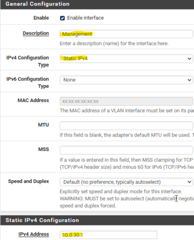
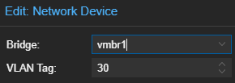

# **VLAN Configuration** 

# **1. Overview** 

- Explain the purpose of VLANs in your network. 

- Describe how VLANs provide network segmentation. 

# **2. VLAN Design** 

Include a table describing each VLAN. 

|**VLAN ID **|**VLAN Name**|**Subnet**|**Default Gateway**|
|---|---|---|---|
|10|EMPLOYEES|10.0.10.0/24|10.0.10.1|
|20|SERVERS|10.0.20.0/24|10.0.20.1|
|30|MANAGEMENT|10.0.30.0/24|10.0.30.1|

# **3. VLAN Configuration** 

# **VLAN 10 - EMPLOYEES** 

- VLAN ID: 10 

- Subnet: 10.0.10.0/24 

- Default Gateway: 10.0.10.1 

- DHCP Range: 10.0.10.2 – 10.0.10.100 

- Purpose: VLAN 10 is configured to allow employees joining and leaving the network by using DHCP 

# **Configuration Details:** 

<u>pfSense -</u> 

Using pfSense, the EMPLOYEES interface is configured using a static IPv4 address of 10.0.10.1 

# - <u>Proxmox configuration</u> 

Bridge vmbr1(LAN) is tagged with VLAN 10 Tag 

# - <u>WinServer DHCP confgurationi</u> 

Windows Server DHCP scope for EMPLOYEES subnet is configured with a scope of 10.0.10.2 – 10.0.10.100 

# - <u>DHCP Relay confgurationi</u> 

# **VLAN 20 - SERVERS** 

- VLAN ID: 20 

- Subnet: 10.0.20.0/24 

- Default Gateway: 10.0.20.1 

- DHCP Range: DHCP not configured 

- Purpose: Separate VLAN for servers to safely store and compute data. DHCP disabled to keep static IPs on servers 

# **Configuration Details:** 

- <u>pfSense</u> 

Using pfSense, the SERVERS interface is configured with a static IPv4 address of 10.0.20.1 

# - <u>Proxmox configuration</u> 

Bridge vmbr1(LAN) is tagged with VLAN 20 Tag 

# **VLAN 30 – MANAGEMENT** 

- VLAN ID: 30 

- Subnet: 10.0.30.0/24 

- Default Gateway: 10.0.30.1 

- DHCP Range: DHCP not configured 

- Purpose: A secure VLAN for management of the network to reside 

# **Configuration Details:** 

- <u>pfSense</u> 

Using pfSense, the MANAGEMENT interface is configured with a static IPv4 address of 10.0.30.1 

- <u>Proxmox configuration</u> 

Bridge vmbr1(LAN) is tagged with the VLAN 20 Tag 

# **6. Verification** 

How VLAN configurations were verified 

- Confirmed clients received the correct IP addresses. 

- Verified default gateway connectivity. 

- Tested communication between devices on the same VLAN. 

- Verified DNS resolution. 

- Tested firewall rules between VLANs. 

See Connectivity Testing for detailed test results. 

# **7. Conclusion** 

Three VLANs were successfully configured using pfSense and Proxmox to separate employee devices, servers, and network management into individual subnets. Each VLAN was assigned its own default gateway, with DHCP configured for the Employees network and static IP addressing used for the Servers and Management networks. Firewall rules were implemented to restrict unauthorized communication between VLANs while allowing necessary network services. These configurations improved network organization, provided greater control over network traffic, and added an additional layer of security through network segmentation. 

