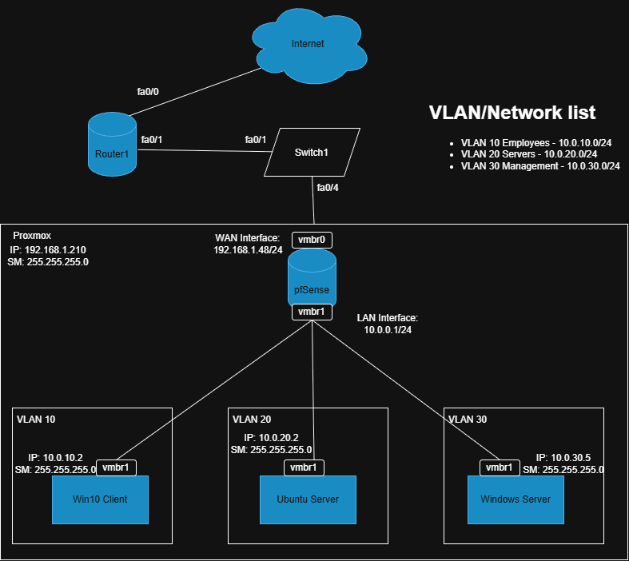

# **Proxmox SOHO Network Lab** 

# **Project Overview** 

This project involved designing and deploying a virtual Small Office/Home Office (SOHO) network using Proxmox, pfSense, and Windows Server. The network was segmented into three VLANs with separate subnets to improve network organization and security. 

pfSense was configured as the network's router and Firewall. Firewall rules were implemented to restrict inter-VLAN traffic, while Windows Server provided DHCP and DNS services for the network. 

# **Objectives** 

- Build a virtualized SOHO network using Proxmox. 

- Configure pfSense for routing and firewall services. 

- Implement VLANs and subnetting for network segmentation. 

- Restrict inter-VLAN communication using firewall rules. 

- Configure Windows Server as a DNS and DHCP server. 

- Verify network connectivity and firewall functionality. 

# **Technologies Used** 

- Proxmox VE 

- pfSense 

- Windows Server 

- VLANs (802.1Q) 

- IPv4 Subnetting 

- DHCP 

- DNS 

- Firewall Rules 

# **Network Topology** 

# **Network Configuration** 

**Component Configuration** Hypervisor Proxmox VE Router/Firewall pfSense DHCP Server pfSense DNS Server Windows Server VLANs 3 

Network Segmentation Separate subnets 

Inter-VLAN Traffic Restricted by firewall rules 

# **Testing and Validation** 

Network connectivity was tested to verify that devices could communicate with their configured gateways and network services. Firewall rules were tested to confirm that interVLAN traffic was restricted as intended. 

See Connectivity Testing for test results. 

# **Skills Demonstrated** 

- Network virtualization 

- Network administration 

- VLAN configuration 

- IPv4 subnetting 

- Firewall configuration 

- DHCP and DNS administration 

- Network troubleshooting 

- Network security 

